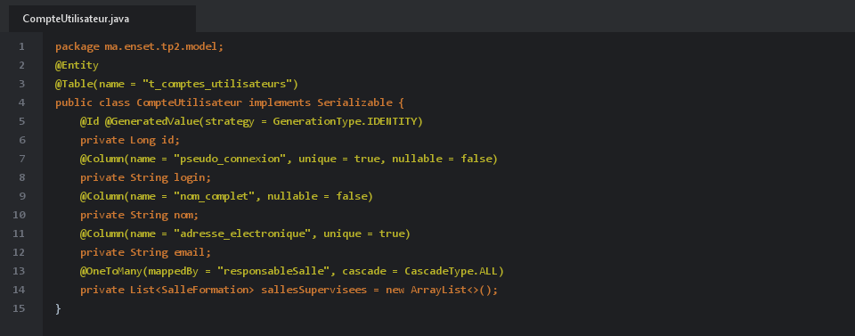
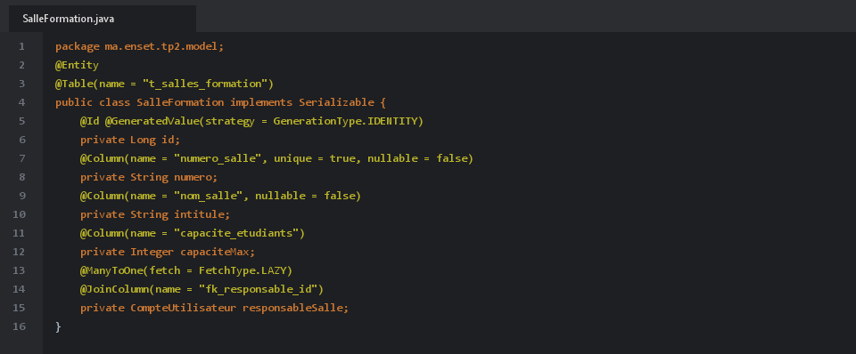
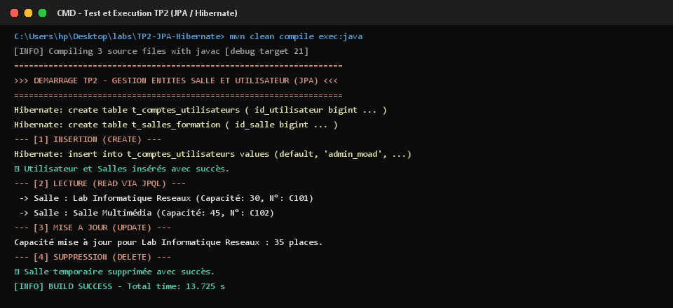

# TP 2 : Gestion des Entités Salle et Utilisateur avec JPA et Hibernate

Projet de manipulation des entités fondamentales `CompteUtilisateur` et `SalleFormation` avec **JPA 2.2** et **Hibernate ORM 5.6** sur base **H2 Database**.

---

## 1. Structure des Entités & Classes Java

### Entité CompteUtilisateur


### Entité SalleFormation


---

## 2. Opérations CRUD Implémentées

1. **Create** : Persistance d'un compte utilisateur superviseur et de plusieurs salles associées.
2. **Read** : Requête JPQL `SELECT s FROM SalleFormation s WHERE s.avecProjecteur = true`.
3. **Update** : Modification dynamique de la capacité d'accueil d'une salle existante.
4. **Delete** : Création puis suppression d'une entité temporaire via `em.remove()`.

---

## 3. Résultats et Traces d'Exécution dans le Terminal (CMD)

Voici la trace complète de la compilation et du test d'exécution dans la console :



---

## 4. Démarrage du Projet

```bash
# Compilation du projet
mvn clean compile

# Exécution de l'application
mvn exec:java "-Dexec.mainClass=ma.enset.tp2.App"
```
